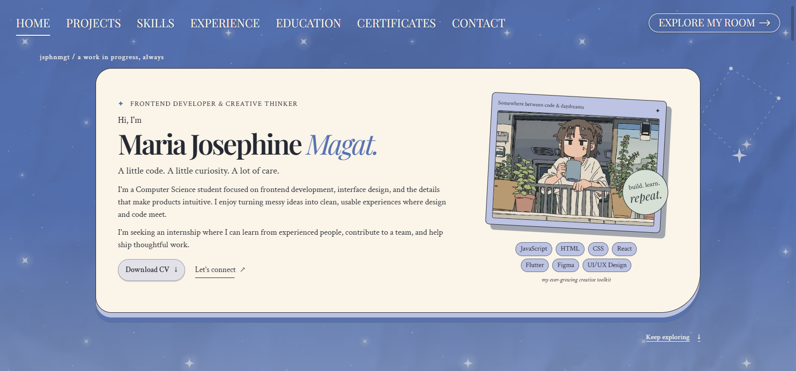

# jsphnmgt Portfolio

A personal portfolio by **[Maria Josephine Magat](https://github.com/jsphnmgt)**, a Computer Science student interested in frontend development and interface design.

The website brings together my work and the interests behind it. Its professional side presents my projects, skills, and background, while an interactive room offers a more personal introduction through the stories, games, and music I enjoy.

[View the repository](https://github.com/jsphnmgt/jsphnmgt-portfolio)



## Explore my work

The professional side introduces what I do and what I’m learning.

| Section | What you’ll find |
| --- | --- |
| **Home** | A short introduction, my CV, and a way to connect. |
| **Projects** | Solo and group work, with previews and project details. |
| **Skills and tools** | Development, databases, design tools, and soft skills. |
| **Experience** | My roles and contributions in student organizations. |
| **Education** | My academic background and current studies. |
| **Certificates** | Completed courses and certifications, with images and credential links. |
| **Contact** | My email, GitHub, and LinkedIn. |

Open a project card to see its screenshots, description, my contribution, and available code links. Certificate cards open the certificate image and its credential link. The contact section provides my email, GitHub, and LinkedIn.

### Featured projects

| Project | Type | About |
| --- | --- | --- |
| **CapsiCAM** | Group project | An Android application that classifies chili pepper leaf images and provides visual explanations of its predictions. |
| **Course Companion** | Solo project | A website for organizing lessons, tracking progress, and accessing learning resources. |
| **HAUlam** | Group project | A mobile application for discovering food stalls and dishes at Holy Angel University. |
| **MYSTICA** | Solo project | A Studio Ghibli-inspired website featuring films, characters, and their worlds. |
| **Bookshelf** | Solo project | Project details and screenshots coming soon. |

## Step into my room

Choose **Explore my room** to enter an illustrated bedroom overlooking a purple city skyline. Each interactive object opens a different part of my personal collection.

| Corner | What you’ll find |
| --- | --- |
| **Personal Computer** | A file explorer with an introduction to me and shortcuts to my favorites and current interests. |
| **Watchlist** | Favorite movies and series, current watches, completed titles, and personal ratings. |
| **Reading List** | Favorite stories, current reads, and finished titles, with authors and ratings. |
| **Game Shelf** | Favorite games and current saves, presented through an interactive DS and a cartridge collection. |
| **Music Corner** | Favorite songs, playlists, genres, and artists, with a record player and links to listen on Spotify. |

Click or tap an object, or choose a collection from **Explore Room**. On tablet and mobile, swipe sideways to see more of the room. Open collection cards for details, then use **Back to portfolio** to return to my work.

## Design and experience

The professional side uses cream paper cards, serif typography, stars, and blue and green backgrounds. The room carries that personal, whimsical feel into objects you can explore.

The layouts adapt to desktop, tablet, and mobile screens, with keyboard navigation and support for reduced motion.

## Built with

React, Vite, and CSS, with designs developed in Figma. Music links open Spotify to listen.

## File structure

```text
client/
  public/                   Downloadable files
  src/
    assets/                 Artwork, screenshots, icons, and optimized images
    components/
      ProfessionalSide/     Portfolio sections and project/certificate overlays
      PersonalSide/         Interactive room and collection overlays
    data/                   Personal collections and project showcase content
    hooks/                  Shared interaction and animation logic
    styles/                 Shared and responsive styles
    App.jsx                 Switches between the portfolio and room
    main.jsx                Application entry point
    styles.css              Base stylesheet imports
  scripts/                  Image optimization and browser checks
  index.html                Main HTML page
  package.json              Dependencies and development commands
  vite.config.js            Build configuration
scripts/                    Collection artwork and metadata helpers
.github/workflows/          Deployment workflow
```

## Run locally

With Node.js 20 or later and npm installed:

```sh
cd client
npm ci
npm run dev
```

Open the local address printed in your terminal.

## License

The code is available under the [MIT License](LICENSE). Third-party artwork and media belong to their respective owners.
